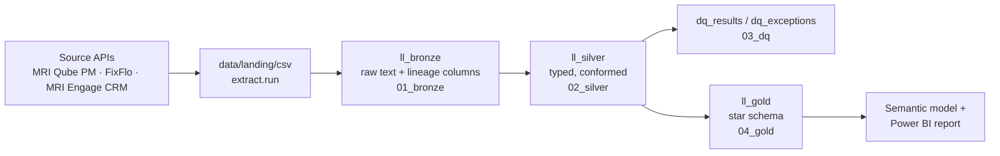

# Lineage

<!-- Generated by governance/build_docs.py from the data dictionary; do not edit. -->

## Layers

## Bronze → Silver, by table

```mermaid
flowchart LR
  subgraph qube["MRI Qube PM"]
    qube_blocks
    qube_compliance_certificates
    qube_income_categories
    qube_landlord_bank_accounts
    qube_landlords
    qube_properties
    qube_property_owners
    qube_purchase_invoices
    qube_staff
    qube_suppliers
    qube_suspense_items
    qube_tenancies
    qube_tenancy_tenants
    qube_tenants
    qube_transactions
  end
  subgraph fixflo["FixFlo"]
    fixflo_agents
    fixflo_blocks
    fixflo_contractors
    fixflo_issues
    fixflo_job_completion_details
    fixflo_jobs
    fixflo_properties
    fixflo_quotes
  end
  subgraph engage["MRI Engage CRM"]
    engage_applicants
    engage_listings
    engage_negotiators
    engage_offers
    engage_viewings
  end
  subgraph ref["Generated in Fabric"]
    dim_calendar
  end
  qube_staff --> silver_staff
  engage_negotiators --> silver_staff
  fixflo_agents --> silver_staff
  qube_blocks --> silver_block
  fixflo_blocks --> silver_block
  qube_properties --> silver_property
  fixflo_properties --> silver_property
  qube_landlords --> silver_landlord
  qube_landlord_bank_accounts --> silver_landlord
  qube_tenants --> silver_tenant
  engage_applicants --> silver_applicant
  qube_tenancies --> silver_tenancy
  qube_tenancy_tenants --> silver_tenancy_tenant
  qube_property_owners --> silver_ownership
  qube_transactions --> silver_rent_transaction
  qube_income_categories --> silver_income_category
  qube_suspense_items --> silver_suspense_item
  qube_suppliers --> silver_supplier
  fixflo_contractors --> silver_supplier
  qube_purchase_invoices --> silver_purchase_invoice
  qube_compliance_certificates --> silver_compliance_certificate
  fixflo_issues --> silver_repair_issue
  fixflo_properties --> silver_repair_issue
  fixflo_jobs --> silver_repair_job
  fixflo_job_completion_details --> silver_repair_job
  fixflo_quotes --> silver_repair_quote
  engage_listings --> silver_listing
  engage_viewings --> silver_viewing
  engage_offers --> silver_offer
  dim_calendar --> silver_calendar
```

## Source endpoint → Bronze → Silver

| Source endpoint | Bronze table | Silver table(s) |
|---|---|---|
| GET https://[MRIWebDomain]/qube/api/v1/staff/{StaffCode} | qube_staff | silver_staff |
| GET https://[MRIWebDomain]/qube/api/v1/blocks/{BlockRef} | qube_blocks | silver_block |
| GET https://[MRIWebDomain]/qube/api/v1/properties/{PropertyRef} | qube_properties | silver_property |
| GET https://[MRIWebDomain]/qube/api/v1/tenants/{TenantRef} | qube_tenants | silver_tenant |
| GET https://[MRIWebDomain]/qube/api/v1/tenancies/{TenancyRef} | qube_tenancies | silver_tenancy |
| GET https://[MRIWebDomain]/qube/api/v1/tenancies/{TenancyRef}/tenants | qube_tenancy_tenants | silver_tenancy_tenant |
| GET https://[MRIWebDomain]/qube/api/v1/tenancies/{TenancyRef}/transactions | qube_transactions | silver_rent_transaction |
| GET https://[MRIWebDomain]/qube/api/v1/properties/{PropertyRef}/certificates | qube_compliance_certificates | silver_compliance_certificate |
| GET https://[MRIWebDomain]/qube/api/v1/suppliers/{SupplierCode} | qube_suppliers | silver_supplier |
| GET https://[MRIWebDomain]/qube/api/v1/purchase-invoices/{InvoiceId} | qube_purchase_invoices | silver_purchase_invoice |
| GET https://[MRIWebDomain]/qube/api/v1/suspense-items/{ItemId} | qube_suspense_items | silver_suspense_item |
| GET https://[MRIWebDomain]/MRIAPIServices/api.asp?$api=resident-contact&RMPROPID={property}&$format=json  (API name and fields from the MRI guide, Figure 1) | qube_resident_contact | – |
| GET https://[MRIWebDomain]/MRIAPIServices/api.asp?$api=income-categories&$format=json  (API name and fields from the MRI guide) | qube_income_categories | silver_income_category |
| GET https://[MRIWebDomain]/qube/api/v1/landlords/{LandlordRef} | qube_landlords | silver_landlord |
| GET https://[MRIWebDomain]/qube/api/v1/properties/{PropertyRef}/owners | qube_property_owners | silver_ownership |
| GET https://[MRIWebDomain]/qube/api/v1/landlords/{LandlordRef}/bank-accounts | qube_landlord_bank_accounts | silver_landlord |
| GET /Property/Search?pg={n}&pgsz={size}  (one property: GET /Property?Id={id} or ?ExternalPropertyRef={ref}) | fixflo_properties | silver_property, silver_repair_issue |
| GET /Issues?UpdatedSince={watermark}&page={n} returns issue URLs, then GET /Issue/{Id} for each | fixflo_issues | silver_repair_issue |
| GET /Job/{id}  (also nested as Job in GET /Issue/{Id}) | fixflo_jobs | silver_repair_job |
| GET /Issue/{issueid}/jobcompletiondetails | fixflo_job_completion_details | silver_repair_job |
| GET /Issue/{issueId}/quotes | fixflo_quotes | silver_repair_quote |
| GET /Contractors  (one: GET /Contractor/{id}) | fixflo_contractors | silver_supplier |
| GET /Blocks  (one: GET /Block) | fixflo_blocks | silver_block |
| GET /Agents  (one: GET /Agent) | fixflo_agents | silver_staff |
| GET https://[EngageDomain]/engage/api/v1/negotiators/{NegotiatorCode} | engage_negotiators | silver_staff |
| GET https://[EngageDomain]/engage/api/v1/applicants/{ApplicantId} | engage_applicants | silver_applicant |
| GET https://[EngageDomain]/engage/api/v1/listings/{ListingId} | engage_listings | silver_listing |
| GET https://[EngageDomain]/engage/api/v1/listings/{ListingId}/viewings | engage_viewings | silver_viewing |
| GET https://[EngageDomain]/engage/api/v1/listings/{ListingId}/offers | engage_offers | silver_offer |
| Built in Fabric (no API) | dim_calendar | silver_calendar |

Every Bronze row carries `_source_file`, `_run_id`, `_ingested_at` and `_source_system`; every Silver row carries `source_system`, `source_table` and `loaded_at`, so any reported figure can be traced back to the load and file it came from.
